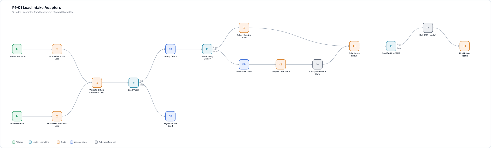
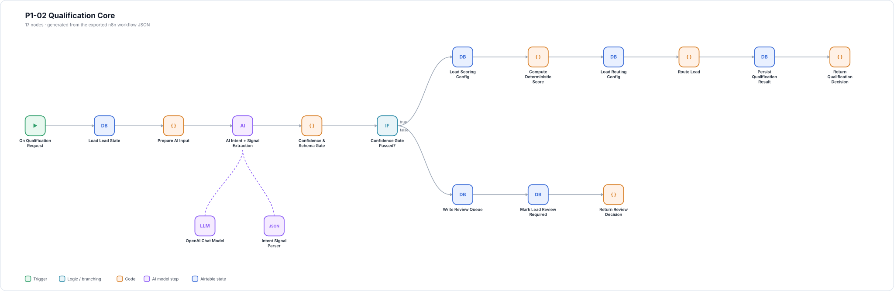
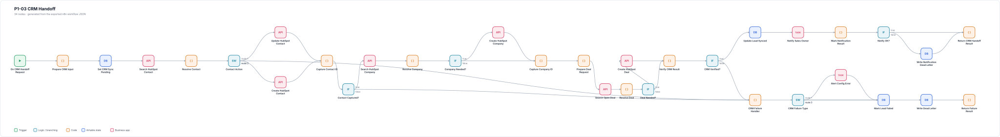
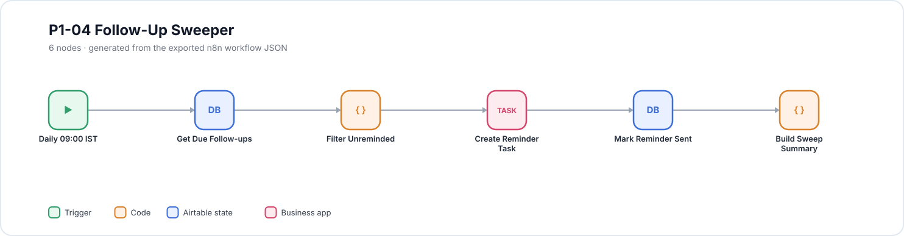
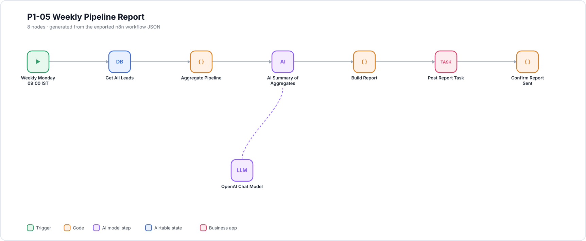

# Workflow maps

Each map is generated from the exported workflow JSON in [`workflows/`](../workflows) by
[`scripts/render-workflow-maps.mjs`](../scripts/render-workflow-maps.mjs). They show the
node layout, branches and AI sub-nodes exactly as they import into n8n. Open an image
to view it at full size.

Regenerate after changing a workflow:

```bash
node scripts/render-workflow-maps.mjs
```

## P1-01 Lead Intake

Form and webhook intake, validation, duplicate check, then calls to qualification and CRM handoff.



## P1-02 Qualification Core

AI intent and signal extraction, confidence gate, rule-based score and route.



## P1-03 CRM Handoff

HubSpot contact, company and deal handling, ID verification, owner notification and failure paths.



## P1-04 Follow-Up Sweeper



## P1-05 Weekly Pipeline Report



## P0-99 Shared Error Handler


